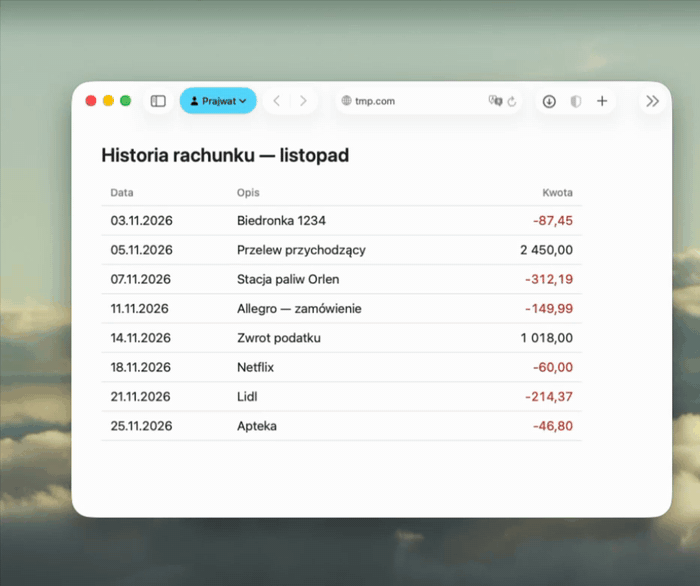

# SumSnap

<p align="center"></p>

Zaznacz obszar na ekranie → dostajesz sumę widocznych kwot.

Aplikacja siedzi w pasku menu (ikona ∑). Po naciśnięciu skrótu kursor zmienia się
w celownik (jak przy ⌘⇧4), zaznaczasz obszar, a po chwili w prawym górnym rogu
pojawia się suma — od razu skopiowana do schowka.
Kwoty ujemne są odejmowane, a pod sumą widać osobno wpływy (+) i wydatki (−).

Cały OCR robi się lokalnie (framework Vision), nic nie wychodzi do sieci.

## Wymagania

- macOS 14 lub nowszy
- Xcode Command Line Tools (`xcode-select --install`), Swift 6

## Instalacja

```bash
git clone https://github.com/sz4rlej/sumsnap.git
cd sumsnap
./build.sh --install
```

Aplikacja ląduje w `/Applications/SumSnap.app` i się uruchamia. Przy pierwszym
użyciu macOS poprosi o zgodę na **Nagrywanie ekranu** — bez niej zrzut będzie
pusty. Po jej włączeniu trzeba aplikację zrestartować (macOS tego wymaga).

Żeby startowała z systemem: menu ∑ → *Uruchamiaj przy starcie*.

## Skrót klawiszowy

Domyślnie **⌃⌥⌘S**. W menu ∑ → *Skrót klawiszowy* można wybrać jeden z czterech
wariantów (⌃⌥⌘S, ⌃⌥⌘4, ⌃⌥⌘D, ⇧⌥⌘S). Jeśli skrót jest zajęty przez inną
aplikację, SumSnap powie o tym przy starcie.

## Menu ∑

- **Zsumuj zaznaczenie** — to samo co skrót
- **Rozpoznane liczby** — lista tego, co zsumował, plus to, co pominął (do weryfikacji)
- **Sumuj bez znaków** — zamiast salda łączna wysokość kwot (wartości bezwzględne)
- **Kopiuj sumę** / **Kopiuj wszystkie liczby** — druga opcja wkleja kolumnę do Excela

## Jak rozpoznaje kwoty

Format polski: `1 234,56`, `1.234,56`, `-890,00`, `(1 200,00)` = kwota ujemna.
Akceptuje twarde i wąskie spacje oraz minus w wersji unicode (−, –).

Przed sumowaniem wyrzuca z tekstu rzeczy, które na wyciągu nie są kwotą:

- daty (`05.08.2026`, `2026-08-11`) i godziny (`12:34`)
- procenty (`4,5 %`)
- numery kont i IBAN-y (`PL61 1090 1014 0000 0712 1981 2874`)
- długie ciągi cyfr (numery dokumentów, NIP-y, telefony)

Dodatkowo działa heurystyka groszowa: **jeśli większość znalezionych liczb ma
część dziesiętną, liczby całkowite są odrzucane** jako śmieci z OCR (numery
stron, LP, fragmenty nazw sklepów w stylu `BIEDRONKA 1234`). HUD pokazuje wtedy
`pominięto N bez groszy`, a pełna lista jest w menu. Gdy żadna liczba nie ma
groszy — sumuje wszystko po kolei.

## Gdy coś nie wychodzi

Zacznij od menu ∑ → **Diagnostyka**:

- *Nagrywanie ekranu: OK / BRAK ZGODY* — stan uprawnienia
- *Pokaż ostatni zrzut* — `~/Library/Logs/SumSnap-last.png`, dokładnie to, co dostał OCR.
  Widać tam tapetę zamiast kwot? To uprawnienia, nie OCR.
- *Pokaż log* — `~/Library/Logs/SumSnap.log`, krok po kroku: rozmiar zrzutu,
  liczba obszarów tekstu, odczytane linie, suma

Tryb diagnostyczny wypisuje, co OCR faktycznie odczytał z dowolnego pliku:

```bash
/Applications/SumSnap.app/Contents/MacOS/SumSnap --file zrzut.png
/Applications/SumSnap.app/Contents/MacOS/SumSnap --selftest zrzut.png   # w warunkach GUI
```

### Uprawnienie do nagrywania ekranu

Bez niego `screencapture` oddaje obraz **bez zawartości okien** — celownik działa
normalnie, ale OCR dostaje samą tapetę i mówi „brak liczb". Objaw myli, bo nic
nie wygląda na zepsute.

Dlatego `build.sh` podpisuje aplikację certyfikatem **Apple Development** z pęku
kluczy, jeśli taki jest. To ważne: przy podpisie ad-hoc każda przebudowa zmienia
hash binarki, a macOS unieważnia wtedy zgodę — przełącznik w Ustawieniach
zostaje włączony, ale system i tak odmawia. Ratunek w takiej sytuacji:

```bash
tccutil reset ScreenCapture pl.softmasters.sumsnap
```

potem uruchomić aplikację i nadać zgodę od nowa.

### Zimny start Vision

Pierwsze rozpoznanie w świeżo uruchomionym procesie potrafi zwrócić zero
obszarów, zanim Vision załaduje modele. Aplikacja robi więc rozgrzewkę zaraz po
starcie, a samo rozpoznawanie ma trzy podejścia (pl+en → domyślne → en).

Jeśli tekst jest odczytany źle — zaznaczaj obszar ciaśniej wokół samej kolumny
kwot i powiększ widok w aplikacji źródłowej. Małe zaznaczenia SumSnap i tak
automatycznie skaluje przed OCR.

## Rozwój

```bash
swift test          # testy parsera kwot
swift build         # build debug
./build.sh          # dist/SumSnap.app bez instalacji
```

Logika parsowania siedzi w `Sources/SumKit/NumberParser.swift` i jest w całości
pokryta testami — to tam dodaje się nowe reguły odrzucania śmieci.
